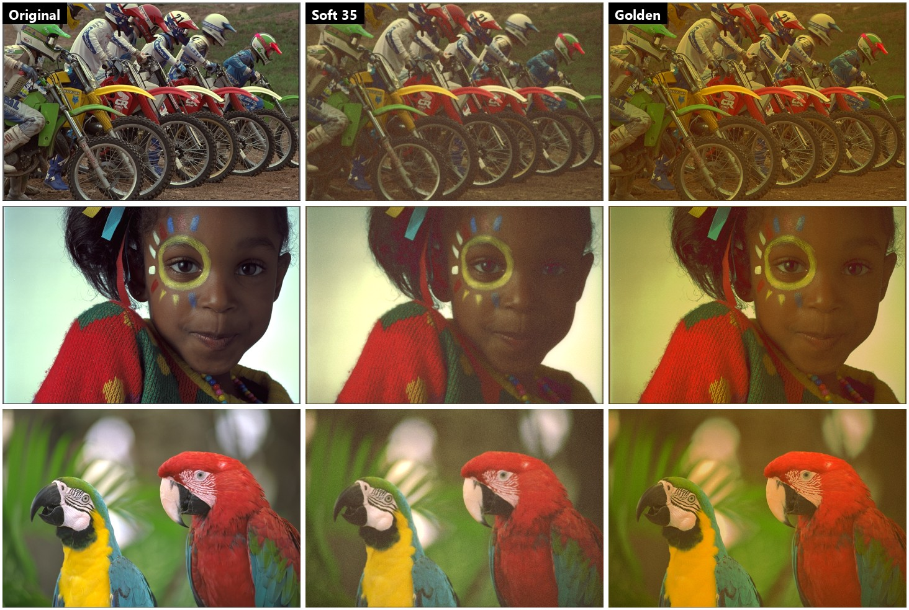
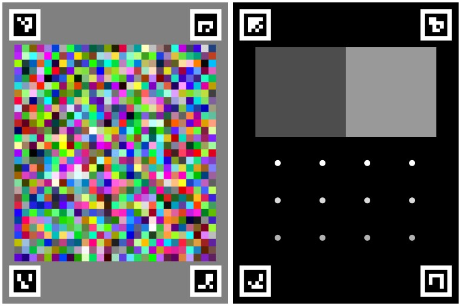
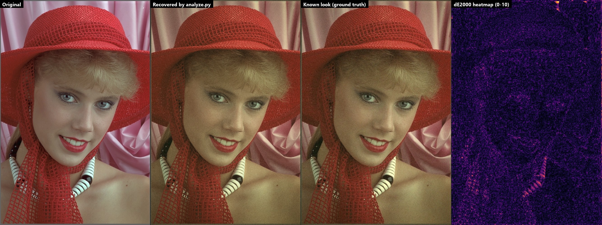

# film-filters

Measure a film-camera filter from a phone app's output and rebuild it as an open preset:
a **3D LUT** (`.cube`) plus **grain, bloom/halation, vignette and lens-softness** parameters.
The presets feed [**dumpcam**](https://github.com/saumya-st/dumpcam), an Android camera that runs them live on the GPU.


<sub>Original vs the two looks shipped in dumpcam (Kodak PhotoCD test images).</sub>

## How it works

1. **Test charts** (`make_charts.py`): two shuffled 783-patch colour charts (a 9×9×9 RGB lattice, a 32-step grey ramp and
   random colours), a softness/bloom chart with a grey edge and bright discs, plus flat black / grey / white frames.
   Charts are 3024×4032 so the app won't crop them.
2. **Run them through the filter**: import each chart into the camera app, apply the look, export.
3. **Measure** (`analyze.py`):
   - **Registration**: each export is aligned to its known chart with coarse-to-fine **ECC homography**
     (ArUco markers are only an optional first guess). The chart type is picked by best correlation, so file names
     don't matter.
   - **Vignette**: a radial polynomial fitted to the flat grey frame.
   - **Softness**: an error-function fit across the grey edge.
   - **Bloom**: a least-squares fit of *background + strength × (Gaussian ∗ disc)* over a σ grid. The threshold
     comes from discs at 3 brightness levels.
   - **Colour**: per-patch medians, corrected for vignette and predicted bloom, then averaged over both shuffles.
     A thin-plate-spline RBF is fitted and sampled to a **33³ LUT**.
   - **Grain**: std against output luminance, size from lag-1 autocorrelation (calibrated against synthetic grain),
     and the mono/chroma ratio.
4. **Apply** (`apply_filter.py`): a NumPy reference pipeline, *blur → LUT → bloom → vignette → grain*. The Android
   GLSL shader uses the same order.



## Validation

`synth_test.py` applies a known look (an analytic LUT plus blur, bloom, vignette and grain), then simulates an app
export (0.8× resize, 1.2° rotation, JPEG q90). It checks how much `analyze.py` recovers:

| Quantity | Ground truth | Recovered |
|---|---|---|
| Colour (4000 random RGB) | — | mean **ΔE2000 0.32**, 95th pct 0.57 |
| Lens softness σ | 1.40 px | 1.42 px |
| Bloom σ / threshold | 35 px / 0.75 | 33.9 px / 0.75 |
| Vignette r² coefficient (R,G,B) | −0.20, −0.22, −0.26 | −0.19, −0.21, −0.25 |
| End-to-end on a photo | — | mean ΔE2000 1.09 (grain removed) |



ΔE2000 ≈ 1 is about the smallest colour difference a person can see.

## The shipped presets

`presets/dclassic*` and `presets/cpm35*` approximate two looks from the iOS app Dazz Cam. No device with the app was
available to run the charts, so `design_looks.py` builds them from **anchor colours measured in a few reference
photos** (dark fabric, skin, white cloth, stone). It fits per-channel PCHIP tone curves through those anchors. They
reproduce the anchors to a mean ΔE2000 of about 1.4, but the overall warmth can't be separated from the scene
lighting. That's why each look ships at full and 60% colour cast (`_soft`), and why dumpcam has a warmth slider.
Running the chart workflow above on a real device would replace these estimates with measured presets.

Only the output is measured; no files, assets or names are taken from any app.

## Usage

```bash
pip install -r requirements.txt

python make_charts.py                              # charts/*.png to import into the app
python analyze.py path/to/exports mylook           # -> presets/mylook.cube + .json + _report.txt
python apply_filter.py photo.jpg mylook out.jpg    # [--no-grain] [--date "'26 10 22"]
python compare.py original.jpg app_export.jpg mylook   # dE2000 stats + side-by-side in report/

python synth_test.py                               # self-test (downloads one Kodak test image)
python design_looks.py [--cast 0.6 --suffix _soft] # rebuild the estimated presets
python export_android.py ../dumpcam/app/src/main/assets   # LUTs + looks.json for the app
python make_docs.py                                # figures in docs/
```

## Files

| File | Purpose |
|---|---|
| `common.py` | chart layout, image I/O, LUT read/write/apply, the reference film pipeline |
| `make_charts.py` | generates the test charts |
| `analyze.py` | measures a look from chart exports |
| `design_looks.py` | builds presets from anchor colours when charts can't be run |
| `apply_filter.py` / `compare.py` | apply a preset / score it against a real export |
| `synth_test.py` | end-to-end self-test with a known look |
| `export_android.py` | writes 33³ RGB8 LUT binaries + `looks.json` for dumpcam |

Python 3.11+, NumPy, SciPy, OpenCV, Pillow, scikit-image.
